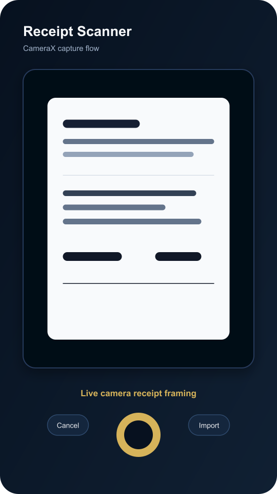
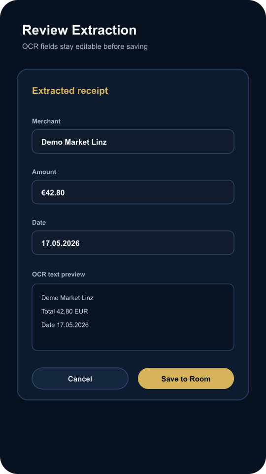
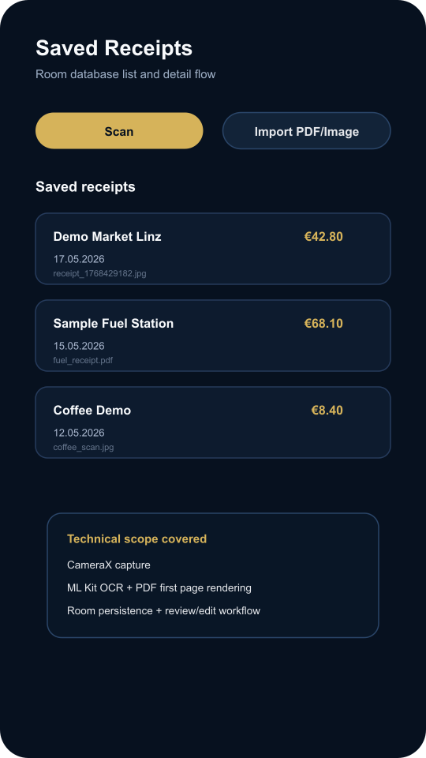

# Receipt Scanner Compose

Native Android receipt scanning demo built with Kotlin, Jetpack Compose, CameraX, ML Kit OCR, and Room.

GitHub: https://github.com/george-killua/receipt-scanner-compose

## Screenshots

| Camera capture | Review extraction | Saved receipts |
| --- | --- | --- |
|  |  |  |

## What It Demonstrates

- CameraX receipt capture flow
- PDF and image import through Android document picker
- ML Kit OCR text recognition for captured/imported receipts
- Extraction of merchant, date, and total amount from OCR text
- Review/edit screen before saving extracted data
- Local original-file storage in app private storage
- Room database persistence for saved receipts
- Compose list/detail UI for saved receipt records

## Architecture

- `ui`: Compose screens, camera preview, and ViewModel state
- `domain`: OCR processing, PDF first-page rendering, file storage, and parser logic
- `data`: Room entity, DAO, database, and repository

## Run

```bash
./gradlew clean :app:assembleDebug
```

Open the project in Android Studio and run the `app` configuration on a device or emulator.

## Production Notes

This is a focused technical demo, not a finished accounting product. Production receipt scanning should add multi-page PDF handling, parser tuning with real sample receipts, confidence scoring, localization, and stronger edge-case validation.
